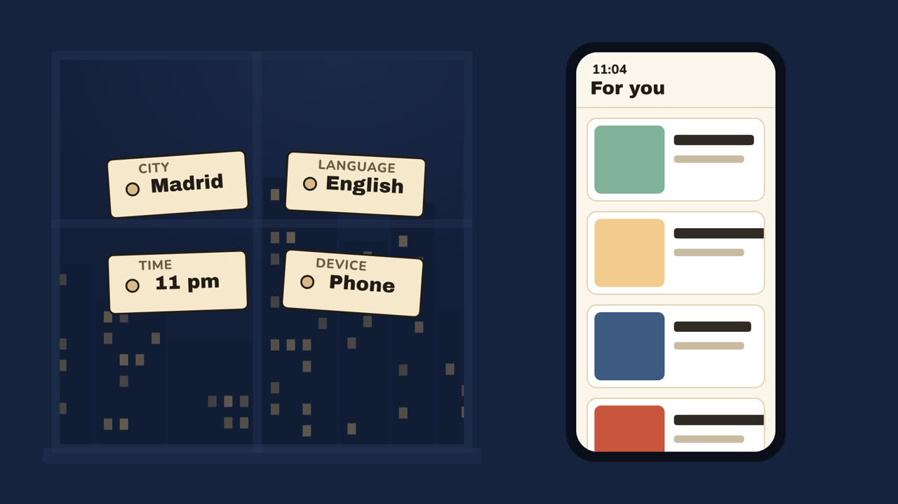
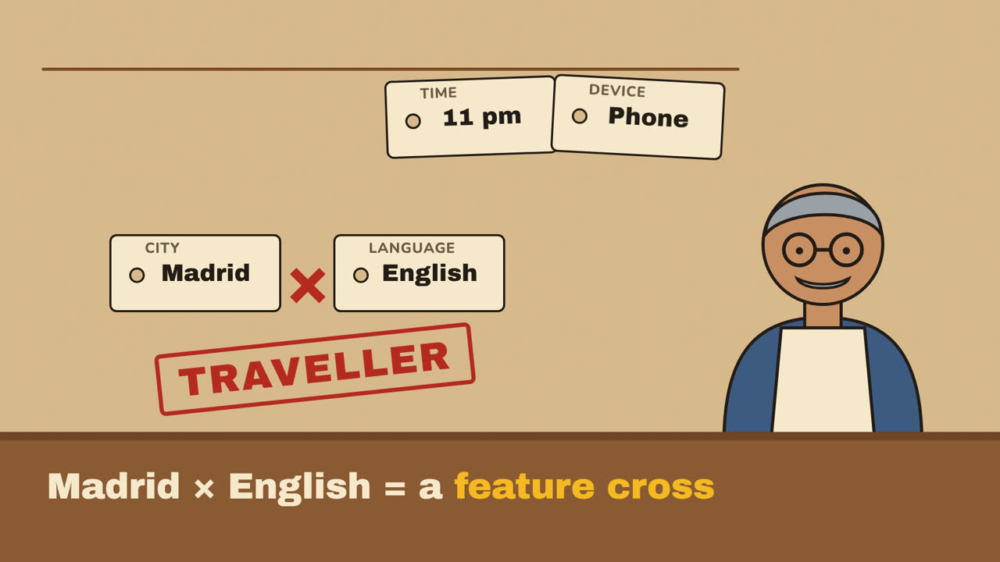
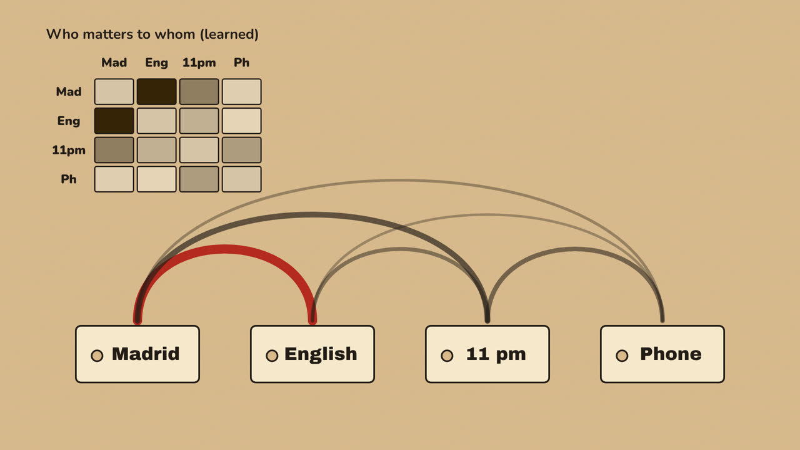
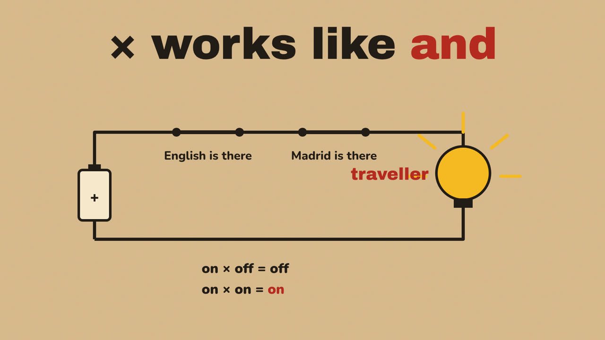
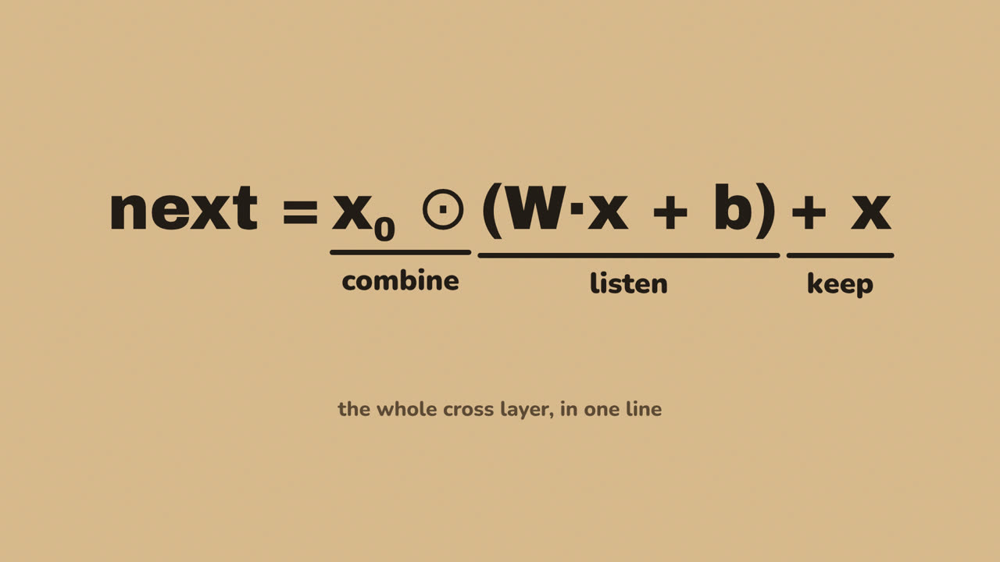
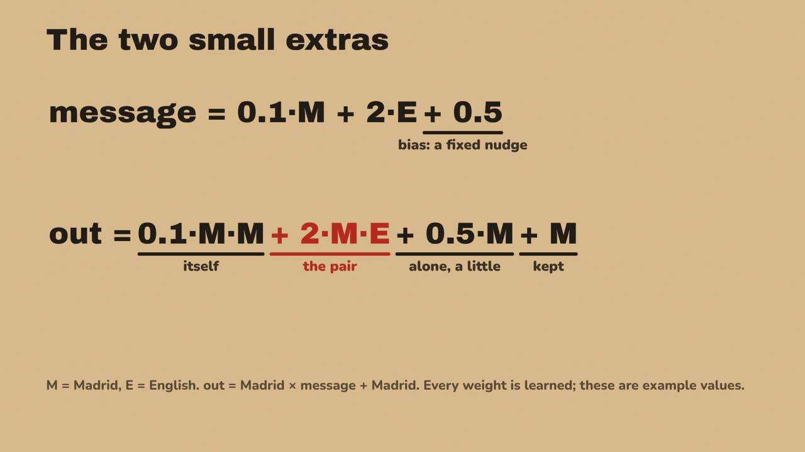
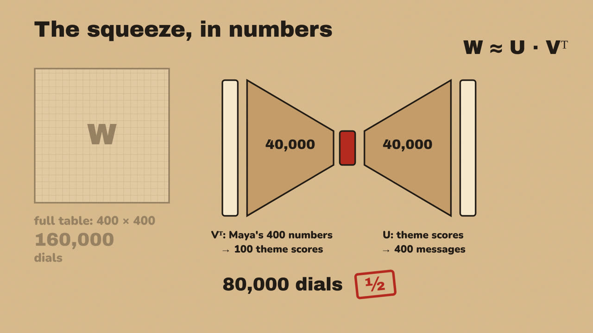
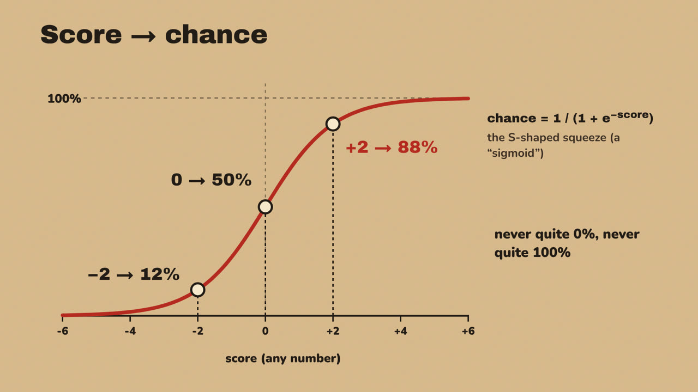
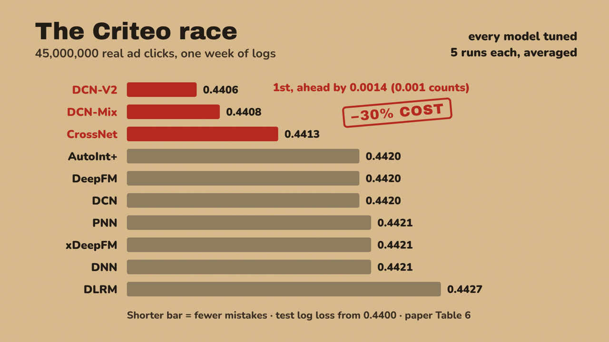
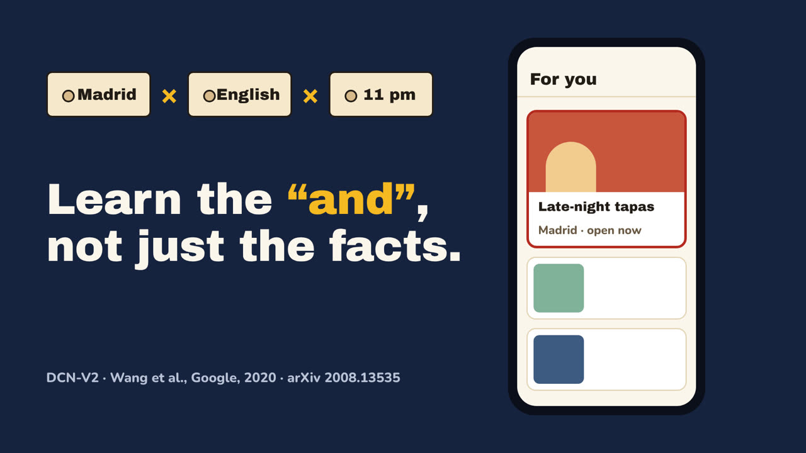

# Design system: the shopkeeper look

The DCN-V2 video's look, so the next film can reuse it or depart from it on purpose.
Tokens live in `dcn-v2-explainer/tools/shared.css`.

## Two worlds

| World | Used for | Ground | Key objects |
| --- | --- | --- | --- |
| **Night** (Maya's world) | the opening and the closing | night blue `#16233f`, a window onto a lit city | a phone with a "For you" feed |
| **Kraft workbench** (the model's world) | every explanation | kraft paper `#d8b98a` with a 9% fibre noise | price tags, rubber stamps, ledgers, circuits, dials |

## Palette and type

| Token | Hex | Rule |
| --- | --- | --- |
| ink | `#221c16` | all text and structure lines |
| tag | `#f6e9cc` | price tags, cards, strips |
| accent red | `#b52a1f` | one focus per frame: the stamp, the key term, the winning bar |
| lamp yellow | `#f5b921` | only for "on / lit" (the bulb, a switched-on fact) |
| string brown | `#7a4e25` | strings, negative bars |

- Display: **Archivo Black**, 64–150 px. Body and labels: **Nunito** 700–900, 28–48 px.
- Minimum readable size 28 px at 1080p.

## Objects that carry ideas

| Idea | Object |
| --- | --- |
| a trait / feature | a price tag with a punched hole and a small category label |
| a combined meaning (feature cross) | a red rubber stamp ("TRAVELLER") |
| multiplication = AND | two switches in series lighting a bulb |
| the cross layer | arcs between tags ("listen"), a product strip ("combine"), adding back ("keep") |
| the weight matrix W | a "who matters to whom" table; a grid of dials, one per pair |
| low rank | an hourglass: many traits → a few themes → back out |
| mixture of experts | a mixing desk; the gate sets the faders |
| prediction | a gauge; an S-curve for score → chance |

## Equations

Equations are shown only after the process they describe. Each term gets an underline and a
plain-words label (classes `.eq .t .u .w` in `shared.css`); the term that matters most is red.

## Data

Real numbers from the source, in bars that start at a stated baseline; the paper's table is named on screen.

## Motion

- Arrivals `expo.out` / `power4.out`, 0.4–0.8 s; camera and colour moves `power2.inOut`; exits `power3.in`, shorter.
- Tags drop in on `back.out(1.4)`. Stamps hit: a 1-frame set at 1.5× scale, then 0.14 s settle.
- Titles blur in (8 px → 0 in 0.2 s) and then hold still.

## Banned

Dark void with floating UI, glow and particles, purple/blue gradients, three cards in a row, bullet slides,
everything fading up at once, text that moves while it is read, the narration repeated on screen.

